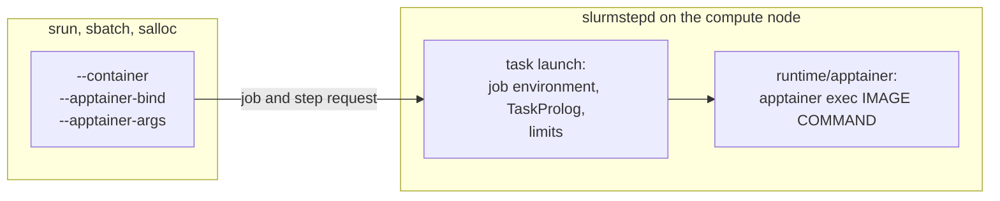

# slurm-runtime-apptainer

`runtime/apptainer` is a runtime plugin for [Slurm](https://slurm.schedmd.com)
26.11 and later. It starts the tasks of a job in an
[Apptainer](https://apptainer.org) container.

```console
$ srun --container=/images/alma9.sif --apptainer-bind=/lustre cat /etc/os-release
$ sbatch --container=/images/alma9.sif job.sh
```

The plugin is the next generation of the SPANK plugin
[slurm-singularity-exec](https://github.com/GSI-HPC/slurm-singularity-exec/tree/main).
It uses the runtime plugin interface that Slurm 26.11 adds.

The documentation is in [docs/content](docs/content) and, as a site, on
<https://gsi-hpc.github.io/slurm-singularity-exec/>.

## How it works



slurmstepd calls the plugin as the last step of the task launch. Thus a task
in a container has the same limits, `TaskProlog` results and `TMPDIR` as a
task on the host. The SPANK plugin replaced the task launch at an earlier
step and lost them.

An MPI program in a container starts with `srun --mpi=pmix`. The plugin
binds the files of the PMIx server of the step into the container.

## Use

| Option | Variable in a job | Function |
|---|---|---|
| `--container=IMAGE` | `SLURM_CONTAINER` | Run the tasks in this image. `none` selects no container. |
| `--apptainer-bind=SPEC,...` | `SLURM_APPTAINER_BIND` | Add bind paths, in the format of `apptainer exec --bind`. |
| `--apptainer-args=ARGS` | `SLURM_APPTAINER_ARGS` | Add arguments to `apptainer exec`. |
| `--apptainer-no-default-binds` | `SLURM_APPTAINER_NO_DEFAULT_BINDS` | Leave out the bind paths of the site. |

`srun`, `sbatch` and `salloc` have these options. Each option has an input
variable for each command, for example `SBATCH_CONTAINER`. The steps of a job
use the options of the job, and each `srun` can replace them.

The cluster selects the plugin for all jobs with
`DefRuntimePlugin=runtime/apptainer` in `slurm.conf`. This is the
recommended setup. Without this parameter, a user selects the plugin with
the variables `SRUN_RUNTIME`, `SBATCH_RUNTIME` and `SALLOC_RUNTIME`, or with
`--runtime=apptainer` as the first option of the command: Slurm gives an
option to the runtime that is selected when it reads the option.

The file `apptainer.conf`, next to `slurm.conf`, sets the defaults of the
site. See [etc/apptainer.conf.example](etc/apptainer.conf.example).

## Build

The runtime plugin interface is internal to Slurm. The plugin compiles
against the configured source tree of the Slurm release that loads it.

```console
$ meson setup build -Dslurm_source=/path/to/slurm --prefix=/usr --libdir=lib64
$ meson compile -C build
$ meson install -C build
```

`meson install` puts `runtime_apptainer.so` into `<libdir>/slurm`. Set
`-Dplugindir` if the `PluginDir` of the cluster is a different directory.
Slurm loads the plugin only if it has the version of Slurm itself. Build it
again for each update of Slurm. Install it on the submit hosts and on the
compute nodes.

## Develop

[mise](https://mise.jdx.dev) installs the tools and runs the tasks.

```console
$ mise install
$ mise run check        # linters, unit tests, links of the documentation
$ mise run e2e          # end-to-end tests on a sind cluster
$ mise run docs:serve   # documentation site on http://localhost:8000
$ mise tasks            # all tasks
```

The end-to-end tests need Docker. They create a
[sind](https://github.com/GSI-HPC/sind) cluster from the node image
`ghcr.io/gsi-hpc/slurm-runtime-apptainer/sind-node:26.11`, which has
Slurm 26.11 and Apptainer. [image/Dockerfile](image/Dockerfile) builds it.

## License

GPL-3.0-or-later, see [LICENSE](LICENSE).
